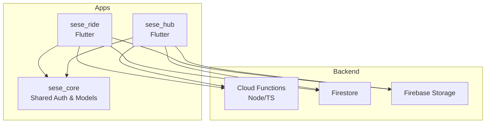
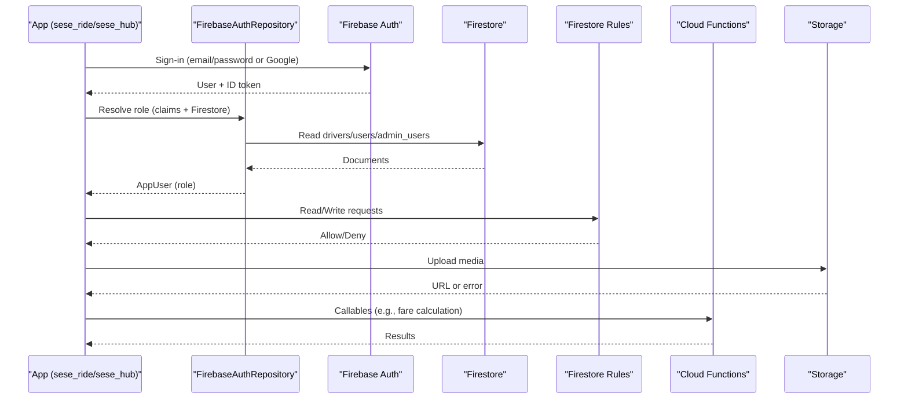
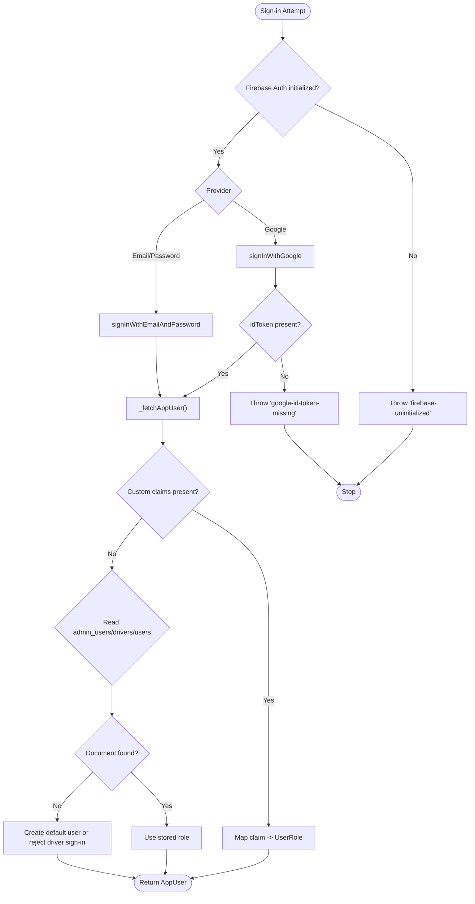
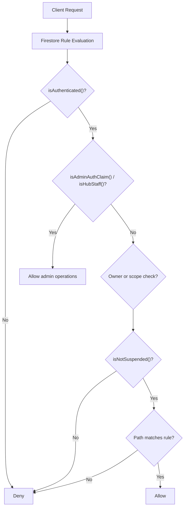
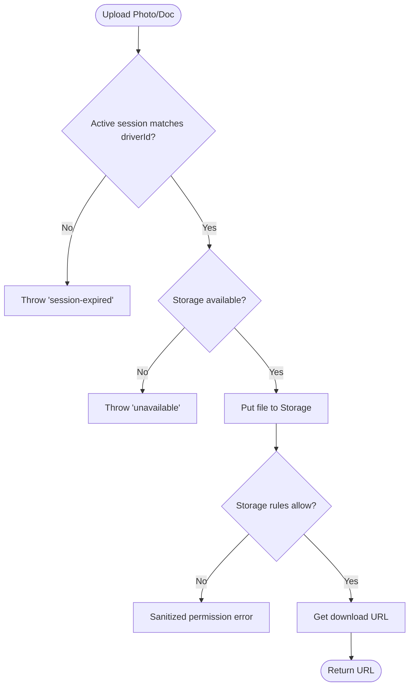
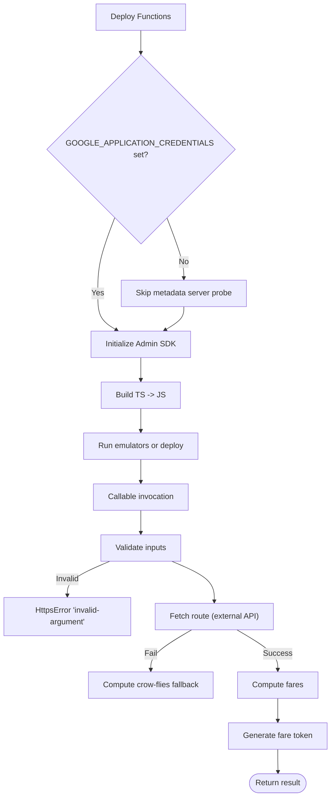
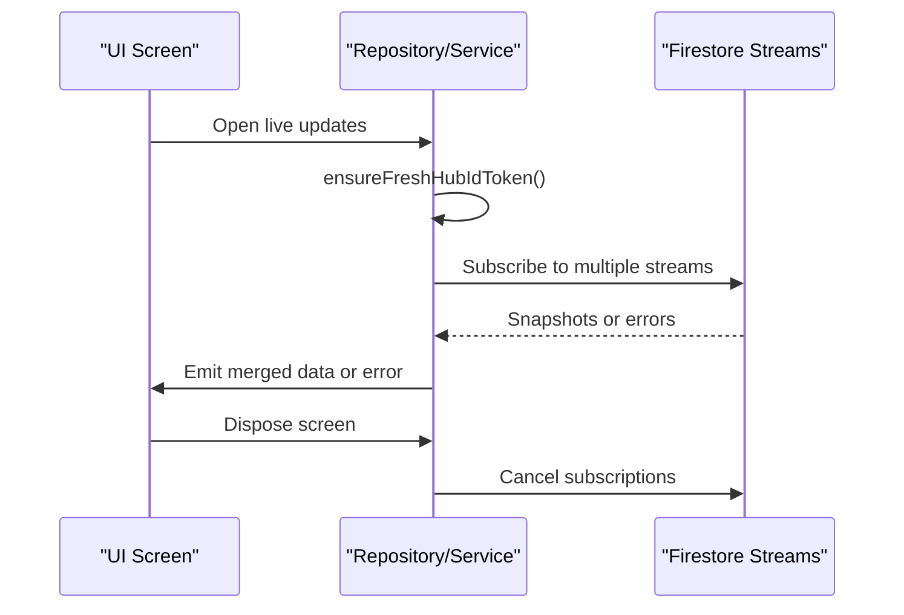
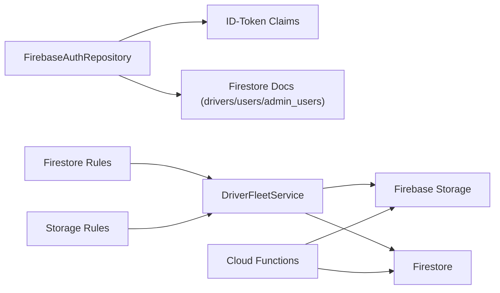

# Troubleshooting Guide

<cite>
**Referenced Files in This Document**
- [firebase.json](file://firebase.json)
- [firestore.rules](file://firestore.rules)
- [storage.rules](file://storage.rules)
- [functions/src/index.ts](file://functions/src/index.ts)
- [functions/package.json](file://functions/package.json)
- [sese_core/lib/auth/firebase_auth_repository.dart](file://sese_core/lib/auth/firebase_auth_repository.dart)
- [sese_hub/lib/features/auth/login_page.dart](file://sese_hub/lib/features/auth/login_page.dart)
- [sese_hub/lib/features/auth/hub_session_guard.dart](file://sese_hub/lib/features/auth/hub_session_guard.dart)
- [sese_ride/lib/features/driver/services/driver_fleet_service.dart](file://sese_ride/lib/features/driver/services/driver_fleet_service.dart)
- [sese_hub/lib/features/verification/presentation/driver_profile_approvals_tab.dart](file://sese_hub/lib/features/verification/presentation/driver_profile_approvals_tab.dart)
- [sese_hub/lib/features/verification/services/fleet_repository.dart](file://sese_hub/lib/features/verification/services/fleet_repository.dart)
</cite>

## Table of Contents
1. [Introduction](#introduction)
2. [Project Structure](#project-structure)
3. [Core Components](#core-components)
4. [Architecture Overview](#architecture-overview)
5. [Detailed Component Analysis](#detailed-component-analysis)
6. [Dependency Analysis](#dependency-analysis)
7. [Performance Considerations](#performance-considerations)
8. [Troubleshooting Guide](#troubleshooting-guide)
9. [Conclusion](#conclusion)

## Introduction
This troubleshooting guide focuses on diagnosing and resolving common issues across authentication, Firestore permissions, Storage uploads, Cloud Functions deployment, real-time streams, and runtime session behavior. It provides step-by-step procedures, log analysis techniques, and targeted checks for the Sese Ride / Hub codebase.

## Project Structure
The project is a multi-app Firebase system:
- `sese_ride`: Rider and driver Flutter app.
- `sese_hub`: Hub staff Flutter app.
- `sese_core`: Shared auth and domain logic.
- `functions`: Node.js Cloud Functions (TypeScript).
- Security rules: Firestore and Storage rules at repository root.
- Deployment configuration: `firebase.json`.

**Diagram sources**
- [firebase.json:1-27](file://firebase.json#L1-L27)
- [functions/src/index.ts:1-20](file://functions/src/index.ts#L1-L20)

**Section sources**
- [firebase.json:1-27](file://firebase.json#L1-L27)

## Core Components
- Authentication and role resolution: `FirebaseAuthRepository` resolves roles from ID-token claims, hub staff records, and user documents.
- Hub login UI: Maps Firebase Auth exceptions to user-friendly messages and enforces hub access qualification.
- Driver fleet service: Manages vehicle data and uploads with sanitized error messages and session validation.
- Cloud Functions entrypoint: Initializes Admin SDK safely and exposes callable endpoints.
- Security rules: Enforce RBAC, suspension checks, and write constraints for Firestore and Storage.

**Section sources**
- [sese_core/lib/auth/firebase_auth_repository.dart:13-20](file://sese_core/lib/auth/firebase_auth_repository.dart#L13-L20)
- [sese_hub/lib/features/auth/login_page.dart:8-11](file://sese_hub/lib/features/auth/login_page.dart#L8-L11)
- [sese_ride/lib/features/driver/services/driver_fleet_service.dart:9-23](file://sese_ride/lib/features/driver/services/driver_fleet_service.dart#L9-L23)
- [functions/src/index.ts:1-20](file://functions/src/index.ts#L1-L20)
- [firestore.rules:6-133](file://firestore.rules#L6-L133)
- [storage.rules:1-14](file://storage.rules#L1-L14)

## Architecture Overview
Authentication and authorization flow:
- Client apps authenticate via Firebase Auth.
- Role resolution reads custom claims, then Firestore documents (`drivers`, `users`, `admin_users`).
- Firestore rules enforce per-document access and business constraints.
- Storage rules restrict uploads by owner and file type/size.
- Cloud Functions perform server-side computations and privileged writes.

**Diagram sources**
- [sese_core/lib/auth/firebase_auth_repository.dart:519-670](file://sese_core/lib/auth/firebase_auth_repository.dart#L519-L670)
- [firestore.rules:6-133](file://firestore.rules#L6-L133)
- [storage.rules:19-107](file://storage.rules#L19-L107)
- [functions/src/index.ts:81-198](file://functions/src/index.ts#L81-L198)

## Detailed Component Analysis

### Authentication and Role Resolution
Symptoms:
- Users cannot sign in or see generic “sign-in failed” messages.
- Hub staff logged out immediately after login.
- Drivers cannot sign in when selecting “Driver” but no driver document exists.

Root causes and fixes:
- Missing or stale Firebase initialization leads to “firebase-uninitialized”.
- Google Sign-In missing idToken due to SHA mismatch or Play Services issues.
- Hub staff not present in `admin_users` or lacking required claims.
- Driver account missing when signing in as driver.

Diagnostic steps:
- Check for `firebase-uninitialized` exceptions during auth calls.
- Inspect Google Sign-In logs for missing idToken and device-specific errors.
- Verify hub staff presence in `admin_users/{email}` and that claims are minted.
- Ensure driver documents exist under `drivers/{uid}` before driver sign-in.

**Diagram sources**
- [sese_core/lib/auth/firebase_auth_repository.dart:103-121](file://sese_core/lib/auth/firebase_auth_repository.dart#L103-L121)
- [sese_core/lib/auth/firebase_auth_repository.dart:326-360](file://sese_core/lib/auth/firebase_auth_repository.dart#L326-L360)
- [sese_core/lib/auth/firebase_auth_repository.dart:519-670](file://sese_core/lib/auth/firebase_auth_repository.dart#L519-L670)

**Section sources**
- [sese_core/lib/auth/firebase_auth_repository.dart:103-121](file://sese_core/lib/auth/firebase_auth_repository.dart#L103-L121)
- [sese_core/lib/auth/firebase_auth_repository.dart:326-360](file://sese_core/lib/auth/firebase_auth_repository.dart#L326-L360)
- [sese_core/lib/auth/firebase_auth_repository.dart:519-670](file://sese_core/lib/auth/firebase_auth_repository.dart#L519-L670)
- [sese_hub/lib/features/auth/login_page.dart:87-123](file://sese_hub/lib/features/auth/login_page.dart#L87-L123)
- [sese_hub/lib/features/auth/login_page.dart:156-171](file://sese_hub/lib/features/auth/login_page.dart#L156-L171)

### Firestore Permission Issues
Symptoms:
- PERMISSION_DENIED on read/write operations.
- Realtime listeners fail or return empty snapshots.
- Hub staff cannot view pending vehicles.

Root causes and fixes:
- Missing or incorrect custom claims (`adminAuth`, `role`, `scope`).
- Suspension flag set in `users/{uid}` blocking writes.
- Hub staff provisioned without claims; rely on `admin_users/{email}` bridge.
- Incorrect path or collection name in client code.

Diagnostic steps:
- Validate helper functions: `isAuthenticated`, `isAdminAuthClaim`, `isHubStaff`, `isNotSuspended`.
- Confirm `admin_users/{email}` exists for hub staff.
- Check suspension status in `users/{uid}`.
- Review rule paths and allowed operations for the affected collections.

**Diagram sources**
- [firestore.rules:6-133](file://firestore.rules#L6-L133)
- [firestore.rules:166-189](file://firestore.rules#L166-L189)
- [firestore.rules:471-485](file://firestore.rules#L471-L485)

**Section sources**
- [firestore.rules:6-133](file://firestore.rules#L6-L133)
- [firestore.rules:166-189](file://firestore.rules#L166-L189)
- [firestore.rules:471-485](file://firestore.rules#L471-L485)

### Storage Upload Failures
Symptoms:
- Image/document upload fails with permission or network errors.
- Uploaded files not visible or URLs invalid.

Root causes and fixes:
- Unauthenticated or wrong user attempting upload.
- File type or size exceeds Storage rules.
- Network connectivity issues or timeouts.

Diagnostic steps:
- Use sanitized error mapping to classify failures (auth vs network).
- Verify Storage rules for target path and content types.
- Confirm active session matches the intended driver/user.

**Diagram sources**
- [sese_ride/lib/features/driver/services/driver_fleet_service.dart:101-121](file://sese_ride/lib/features/driver/services/driver_fleet_service.dart#L101-L121)
- [sese_ride/lib/features/driver/services/driver_fleet_service.dart:241-286](file://sese_ride/lib/features/driver/services/driver_fleet_service.dart#L241-L286)
- [storage.rules:19-107](file://storage.rules#L19-L107)

**Section sources**
- [sese_ride/lib/features/driver/services/driver_fleet_service.dart:21-58](file://sese_ride/lib/features/driver/services/driver_fleet_service.dart#L21-L58)
- [sese_ride/lib/features/driver/services/driver_fleet_service.dart:101-121](file://sese_ride/lib/features/driver/services/driver_fleet_service.dart#L101-L121)
- [sese_ride/lib/features/driver/services/driver_fleet_service.dart:241-286](file://sese_ride/lib/features/driver/services/driver_fleet_service.dart#L241-L286)
- [storage.rules:19-107](file://storage.rules#L19-L107)

### Cloud Functions Deployment and Runtime Errors
Symptoms:
- Deployment hangs or times out during trigger discovery.
- Callable functions throw unauthenticated or invalid-argument errors.

Root causes and fixes:
- Metadata server probe hanging on local dev machines; skip probe unless credentials provided.
- Missing or malformed request parameters.
- External routing API failure triggers fallback distance computation.

Diagnostic steps:
- Set `GOOGLE_APPLICATION_CREDENTIALS` locally to avoid metadata server probing.
- Validate function inputs (coordinates, service type, tiers).
- Check fallback behavior and external API availability.

**Diagram sources**
- [functions/src/index.ts:1-20](file://functions/src/index.ts#L1-L20)
- [functions/src/index.ts:81-198](file://functions/src/index.ts#L81-L198)
- [functions/package.json:1-24](file://functions/package.json#L1-L24)

**Section sources**
- [functions/src/index.ts:1-20](file://functions/src/index.ts#L1-L20)
- [functions/src/index.ts:81-198](file://functions/src/index.ts#L81-L198)
- [functions/package.json:1-24](file://functions/package.json#L1-L24)

### Real-Time Connection Problems
Symptoms:
- Live updates stop or show session expired.
- Support chat or approval lists do not refresh.

Root causes and fixes:
- Expired ID tokens causing session expiration.
- Multiple stream subscriptions not properly canceled.
- Stream errors propagated only when all maps are empty.

Diagnostic steps:
- Force refresh ID tokens before opening streams.
- Ensure proper disposal of stream subscriptions.
- Handle onError callbacks and propagate errors when appropriate.

**Diagram sources**
- [sese_hub/lib/features/auth/hub_session_guard.dart:107-139](file://sese_hub/lib/features/auth/hub_session_guard.dart#L107-L139)
- [sese_hub/lib/features/verification/presentation/driver_profile_approvals_tab.dart:86-118](file://sese_hub/lib/features/verification/presentation/driver_profile_approvals_tab.dart#L86-L118)
- [sese_hub/lib/features/verification/services/fleet_repository.dart:75-138](file://sese_hub/lib/features/verification/services/fleet_repository.dart#L75-L138)

**Section sources**
- [sese_hub/lib/features/auth/hub_session_guard.dart:107-139](file://sese_hub/lib/features/auth/hub_session_guard.dart#L107-L139)
- [sese_hub/lib/features/verification/presentation/driver_profile_approvals_tab.dart:86-118](file://sese_hub/lib/features/verification/presentation/driver_profile_approvals_tab.dart#L86-L118)
- [sese_hub/lib/features/verification/services/fleet_repository.dart:75-138](file://sese_hub/lib/features/verification/services/fleet_repository.dart#L75-L138)

## Dependency Analysis
Key dependencies and coupling:
- Apps depend on shared auth repository for role resolution.
- Firestore rules enforce business logic and security boundaries.
- Storage rules constrain uploads by owner and file properties.
- Cloud Functions provide server-side authority and compute.

**Diagram sources**
- [sese_core/lib/auth/firebase_auth_repository.dart:519-670](file://sese_core/lib/auth/firebase_auth_repository.dart#L519-L670)
- [sese_ride/lib/features/driver/services/driver_fleet_service.dart:60-99](file://sese_ride/lib/features/driver/services/driver_fleet_service.dart#L60-L99)
- [firestore.rules:6-133](file://firestore.rules#L6-L133)
- [storage.rules:19-107](file://storage.rules#L19-L107)
- [functions/src/index.ts:81-198](file://functions/src/index.ts#L81-L198)

**Section sources**
- [sese_core/lib/auth/firebase_auth_repository.dart:519-670](file://sese_core/lib/auth/firebase_auth_repository.dart#L519-L670)
- [sese_ride/lib/features/driver/services/driver_fleet_service.dart:60-99](file://sese_ride/lib/features/driver/services/driver_fleet_service.dart#L60-L99)
- [firestore.rules:6-133](file://firestore.rules#L6-L133)
- [storage.rules:19-107](file://storage.rules#L19-L107)
- [functions/src/index.ts:81-198](file://functions/src/index.ts#L81-L198)

## Performance Considerations
- Avoid unnecessary re-authentication flows; cache user sessions where safe.
- Minimize Firestore reads by leveraging indexed queries and selective fields.
- Batch updates for related documents to reduce round trips.
- Prefer server-side computations (Cloud Functions) for heavy calculations to keep clients responsive.
- Monitor Storage upload sizes and types to prevent large payloads and rule violations.

[No sources needed since this section provides general guidance]

## Troubleshooting Guide

### Frequent Authentication Errors
Common codes and resolutions:
- `firebase-uninitialized`: Ensure Firebase Auth is initialized before calling any auth methods.
- `google-sign-in-cancelled`: User cancelled Google sign-in; handle gracefully.
- `google-id-token-missing`: Device lacks idToken; verify SHA keys, google-services.json, and Play Services.
- `user-not-found`, `wrong-password`, `invalid-credential`, `too-many-requests`, `user-disabled`: Map to friendly messages and guide users.

Steps:
- Inspect exception codes in login flows.
- For Google Sign-In, validate device environment and certificates.
- For hub staff, confirm qualification via `admin_users` and claims.

**Section sources**
- [sese_core/lib/auth/firebase_auth_repository.dart:103-121](file://sese_core/lib/auth/firebase_auth_repository.dart#L103-L121)
- [sese_core/lib/auth/firebase_auth_repository.dart:326-360](file://sese_core/lib/auth/firebase_auth_repository.dart#L326-L360)
- [sese_hub/lib/features/auth/login_page.dart:156-171](file://sese_hub/lib/features/auth/login_page.dart#L156-L171)

### Database Permission Issues
Symptoms:
- PERMISSION_DENIED on reads/writes.
- Hub staff cannot view pending vehicles.
- Suspension blocks writes.

Steps:
- Validate `isAdminAuthClaim()` and `isHubStaff()` helpers.
- Check `admin_users/{email}` for hub staff entries.
- Verify `users/{uid}.isSuspended` is not true.
- Confirm correct collection paths and field names.

**Section sources**
- [firestore.rules:6-133](file://firestore.rules#L6-L133)
- [firestore.rules:471-485](file://firestore.rules#L471-L485)

### Real-Time Connection Problems
Symptoms:
- Live updates stop; session expired message appears.
- Approval lists or support chats do not refresh.

Steps:
- Force refresh ID tokens before opening streams.
- Ensure stream subscriptions are canceled on dispose.
- Propagate stream errors when all maps are empty.

**Section sources**
- [sese_hub/lib/features/auth/hub_session_guard.dart:107-139](file://sese_hub/lib/features/auth/hub_session_guard.dart#L107-L139)
- [sese_hub/lib/features/verification/presentation/driver_profile_approvals_tab.dart:86-118](file://sese_hub/lib/features/verification/presentation/driver_profile_approvals_tab.dart#L86-L118)
- [sese_hub/lib/features/verification/services/fleet_repository.dart:75-138](file://sese_hub/lib/features/verification/services/fleet_repository.dart#L75-L138)

### Deployment Failures
Symptoms:
- Deployment hangs or times out during trigger discovery.
- Local emulator startup fails.

Steps:
- Set `GOOGLE_APPLICATION_CREDENTIALS` to skip metadata server probe.
- Ensure build scripts run successfully (`npm run build`).
- Use emulators for local testing (`firebase emulators:start --only functions`).

**Section sources**
- [functions/src/index.ts:1-20](file://functions/src/index.ts#L1-L20)
- [functions/package.json:1-24](file://functions/package.json#L1-L24)

### Log Analysis Techniques
- Capture FirebaseAuthException codes and messages during login flows.
- Inspect sanitized upload error messages to distinguish auth vs network failures.
- Review debug prints around role resolution and stream subscriptions.
- Use Crashlytics dashboards to correlate crashes with auth/storage events.

**Section sources**
- [sese_hub/lib/features/auth/login_page.dart:97-123](file://sese_hub/lib/features/auth/login_page.dart#L97-L123)
- [sese_ride/lib/features/driver/services/driver_fleet_service.dart:21-58](file://sese_ride/lib/features/driver/services/driver_fleet_service.dart#L21-L58)
- [sese_core/lib/auth/firebase_auth_repository.dart:519-670](file://sese_core/lib/auth/firebase_auth_repository.dart#L519-L670)

### Debugging Tools Usage
- Firebase Emulator Suite for local functions and database testing.
- Xcode/Android Studio debuggers for app-level breakpoints.
- Crashlytics for crash reporting and stack traces.
- Firestore and Storage consoles to inspect documents and uploaded files.

[No sources needed since this section provides general guidance]

### Diagnostic Procedures for Root Causes
- Reproduce the issue in debug mode with verbose logging enabled.
- Isolate components: test auth, storage, firestore, and functions independently.
- Validate rules and configurations against expected behaviors.
- Correlate timestamps and user IDs across logs and backend services.

[No sources needed since this section provides general guidance]

### Performance Issues, Memory Leaks, and Network Connectivity
- Profile memory usage in Flutter apps; ensure stream subscriptions are disposed.
- Reduce Firestore query complexity; use indexes and limit results.
- Implement retry logic for transient network errors; surface sanitized messages.
- Monitor Cloud Functions cold starts and optimize initialization.

[No sources needed since this section provides general guidance]

## Conclusion
By systematically validating authentication flows, Firestore and Storage rules, Cloud Functions deployment, and real-time stream lifecycle, most issues can be diagnosed and resolved efficiently. Use the provided diagnostic steps, log analysis techniques, and diagrams to pinpoint root causes and apply targeted fixes.